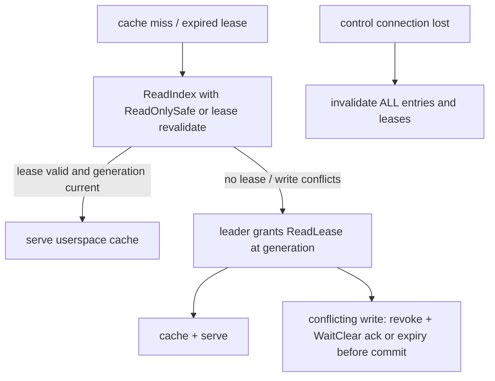

# SyncFS Architecture

> **Reconciled (2026-11-08):** Architecture reflects the unified baseline (FUSE + etcd/raft/v3 + QUIC + Pebble/BLAKE3 strict volume; Camp B state/POSIX-apply/quarantine folded in). Any native-directory/watcher/pull-based sections are superseded — see research/07-design-fork-reconciliation.md §3.5 and decision D-001.

## The design in one sentence

SyncFS places a Linux FUSE client in the application's I/O path and uses a
three-node, quorum-replicated volume service behind it. This is the smallest
design that can make POSIX mutations visible in one order across application
hosts while retaining local disks as the storage medium.

An inotify/fanotify daemon cannot provide that contract: it learns about a
write after the application has already observed success. It can replicate
files, but it cannot prevent split brain, revoke stale reads, coordinate locks,
or make `fsync` mean quorum durability.

## Intended deployment

```text
                    application hosts
       ┌──────────────────────────────────────────────┐
       │ Jira / Confluence / repo manager / artifacts  │
       │        POSIX syscalls at /srv/shared           │
       └──────────────────────┬───────────────────────┘
                              │ /dev/fuse
                    ┌─────────▼─────────┐
                    │ syncfs mount      │  client-only or co-located
                    │ cache + leases    │
                    └─────────┬─────────┘
                     mTLS QUIC│ (multiplexed streams)
         ┌────────────────────┼────────────────────┐
         ▼                    ▼                    ▼
┌────────────────┐   ┌────────────────┐   ┌────────────────┐
│ syncfs daemon  │   │ syncfs daemon  │   │ syncfs daemon  │
│ storage voter  │◄─►│ storage voter  │◄─►│ storage voter  │
│ local XFS/ext4 │   │ local XFS/ext4 │   │ local XFS/ext4 │
└────────────────┘   └────────────────┘   └────────────────┘
       node A                 node B                 node C
```

Three storage nodes should be independent failure domains with reliable
local SSD/NVMe storage and a low-latency LAN. Application hosts may be storage
nodes, but do not need to be. The MVP has no proxying through NFS or SMB and no
external database or control plane.

## Components

| Component | Status | Responsibility |
| --- | --- | --- |
| `syncfs mount` | stub + M3 library surface (in-memory) | `mount` validates `--volume`/`--target` and prints (exit 0/1/2); the FUSE handler, journal, and cache are library components — E2E mount wiring pending (`cmd/syncfs/main.go:150`, `internal/fusefs/fusefs.go:88`). |
| `syncfs daemon` | stub; library core built | `daemon` validates `--config` existence and prints (exit 0/1/2); QUIC endpoints, Raft peer, metadata state machine, chunk store, snapshot, and metrics are library code — E2E daemon wiring pending (`cmd/syncfs/main.go:132`, `internal/transport/session.go:23`). |
| `syncfs admin` | CLI stubs (validate + describe) | Bootstrap, volume, member operations validate flags and describe the control-plane action; they never propose to Raft (`cmd/syncfs/main.go:70`, `docs/reference/cli.md`). |
| Volume Raft group | M2-04 (3-node mesh tested) | Orders namespace/metadata mutations, locks, membership state, lease changes (`internal/raftstore/driver/driver.go:73`). |
| Chunk store | M2-02 + GC (M4-01) | Immutable 64 KiB BLAKE3 chunks, packs, Pebble chunk index, epoch sweeps (`internal/chunkstore/chunkstore.go:1`, `internal/chunkstore/gc/gc.go:1`). |

One Go binary, `syncfs`, with `admin` / `daemon` / `mount` subcommands
(`cmd/syncfs`). Separate processes for storage and mount roles are the
target; the current binaries are validation stubs, not running daemons.
The test fleet (`docker compose run --rm node-a go test ./... -race`) is
the current way to build and verify; no containers, Kubernetes, or
service mesh are required.

## Why a volume has a leader

Every volume has one Raft leader at a time. A client mount can connect to any
storage node, but followers redirect mutating requests to the current leader.
The leader serializes conflicting namespace and inode operations, issues cache
revocations, and proposes the resulting command to the Raft log. Raft terms and
committed indexes fence an old leader: a partitioned node may retain bytes in
its local staging area, but cannot make those bytes visible without a quorum.

This is intentionally different from GlusterFS-style independent bricks. A
private replica is not a writable source of truth. Only the committed volume
state is visible through a SyncFS mount.

## Write path

The critical invariant is: **a successful mutation has durable payload chunks
on a majority of current voters and a committed metadata command that references
those exact chunks.**

The leader never acknowledges a mutation before the quorum condition
holds (Inv.3). There is no bounded group-commit window yet: the spec
§11 target is 0–5 ms (default 2 ms) batched by the volume leader only;
the current coordinator allocates a monotonic Raft index per proposal
and applies one command at a time (`internal/volume/volume.go:23`).
Classed QUIC streams exist in `internal/transport`, but the
coordinator is currently an in-process fan-out over local chunk stores;
end-to-end QUIC pipelining is pending.

```mermaid
sequenceDiagram
    actor App
    participant Fuse as syncfs mount
    participant Leader as volume leader
    participant Majority as storage majority (2/3)
    App->>Fuse: write/rename/fsync
    Fuse->>Leader: OpID (stable 128-bit)
    Leader->>Leader: validate volume, caller, versions, session/lock/lease (step 1)
    Leader->>Leader: duplicate OpID returns retained result (step 2)
    Leader->>Leader: 64KiB COW chunks + candidate manifest (step 3)
    Leader->>Leader: local staging + BLAKE3 verify + durable (step 4a)
    Leader->>Majority: stream chunks to majority (step 4b)
    Majority-->>Leader: durable receipts (peer, hash, gen, bytes) (step 5)
    Leader->>Leader: revoke leases + wait ack or expiry (step 6)
    Leader->>Leader: propose WriteRanges (old versions, manifest, receipts, OpID) (step 7)
    Leader->>Leader: persist WAL + hard state before send; wait commit (step 8)
    Leader->>Leader: fetch missing chunks; atomic apply; record result (step 8)
    Leader-->>Fuse: invalidations, then success (step 9)
```

Uncommitted chunks are harmless garbage: they have no namespace
reference and are reclaimed only after a conservative epoch-based
sweep (`internal/chunkstore/gc/gc.go:59`). Inv.4: a follower may store
a committed log entry before it has all referenced chunks, but it must
not apply the entry or campaign for leader until it has verified those
chunks (`internal/raftstore/driver/driver.go:286`); vote grants are
not gated, so a promoted-but-unapplied voter still votes.

## Read and cache-coherence path

The normal mount mode is `strict`:

1. The volume leader grants a short, renewable read lease for an inode or
   directory to a connected mount.
2. The mount may serve cached data only while that lease is valid.
3. Before a conflicting mutation commits, the leader sends FUSE inode/dentry
   invalidations and waits for each live lease holder to acknowledge revocation
   or time out.
4. A mount that loses its control connection immediately invalidates its leases
   and no longer serves potentially stale cache pages.

This gives local cache speed to read-heavy shared homes without the hidden,
time-based stale reads normally associated with network filesystem clients.
For an operation that needs a fresh answer and has no lease, the mount
performs a linearizable `ReadIndex` read with `ReadOnlySafe` set (spec
§8.3) through the volume group. Client ReadLeases are fenced by the
state-machine generation: `Valid` fails a lease at a stale generation
(`internal/volume/lease/lease.go:99`), and revocation waits are bounded
by `WaitClear` (ack or expiry, 2×TTL ceiling) (`internal/volume/lease/lease.go:114`).
Three leases (Raft leader, client ReadLease, POSIX lock) are never
conflated. On control-connection drop the client clears all entries and
leases (`internal/client/cache/cache.go:58`, `internal/client/client.go:226`)
and fails closed until `Reconnect` folds retained ops via server lookup.

The first strict release keeps mutable-file cache authority in the mount process:
it uses FUSE direct I/O for mutable data and zero/short kernel metadata TTLs.
That makes a paused or disconnected mount block or fail rather than allowing the
kernel to serve an expired page. Kernel page-cache optimization waits for
dedicated suspension and invalidation tests.

Writes are globally visible when their FUSE request succeeds. The initial
implementation does not hide dirty data behind writeback caching, and
`EnableWritebackCache` stays OFF in strict mode (spec §8.3). Only 64 KiB
copy-on-write chunking currently reduces small-write cost; group-commit
batching is a spec target, not yet implemented.



## Data model and local persistence

Each volume has an immutable logical object graph:

```text
directory inode ── dentry(name) ──► file inode ──► file manifest
                                                └── extent map ──► chunk hashes
```

- Inodes have deterministic identifiers (`SHA256(OpID, parent, name)[0:16]`,
  so all replicas derive the same ID for one committed CREATE), ownership,
  mode, timestamps, xattrs, link count, and a monotonically increasing version
  (`internal/metadata/metadata.go:272`).
- A file manifest maps logical ranges to fixed 64 KiB BLAKE3-addressed chunks;
  holes need no physical chunks.
- A metadata command carries expected inode/directory versions. A stale command
  fails rather than silently overwriting a concurrent change.
- Files, manifests, and chunks are immutable once committed. A small overwrite
  replaces only the affected extent(s) and manifest.

On each storage node, the daemon owns a private state directory. The
layout below is the spec §7.5 target; only the paths marked * are
implemented so far:

```text
/var/lib/syncfs/
  identity/              node identity and trusted CA material *
  groups/<group-id>/     Raft WAL (`wal.log`) + snapshot (`snap.bin`) *
  volumes/<volume-id>/
    pebble/              chunk index projection (chunkstore) *
    packs/               pack-*.pack append-only chunk segments *
    staging/             uncommitted upload data (target)
    snapshots/           incoming/outgoing chunk manifests (target)
    quarantine/          forensic evidence (target; today: skip, not copy *)
```

* `internal/chunkstore/chunkstore.go:63` creates `pebble/` and
`pack-*.pack`; `internal/raftstore/wal/wal.go:91` creates `wal.log`;
`internal/raftstore/snapshot/snap.go:23` writes `snap.bin`.

The metadata state machine is an in-memory, rebuildable projection of
the Raft log (`internal/metadata/metadata.go:66`); it is not an
independent authority and is not yet durably persisted in Pebble.
Pebble is the chunk index only: each `Put` fsyncs the pack and its
directory before indexing, then writes the index with
`pebble.Sync` (`internal/chunkstore/chunkstore.go:216`, `:322`). Pack
records are `[crc32(4)][len(3)][hash(32)][data]`
(`internal/chunkstore/chunkstore.go:326`); append-only packs avoid the
many-small-files penalty of one host file per chunk. On-disk formats
are versioned and never shared directly with an application.

WAL records are `[crc32(4)][len(4)][tag+payload]`
(`internal/raftstore/wal/wal.go:8`): torn tails truncate on reopen,
mid-log CRC corruption fails closed and the node stays non-voting
(Inv.9), gaps are validated before any durable write, and the snapshot
is restored before replay. `Compact` refuses to compact beyond the
snapshot (`internal/raftstore/wal/wal.go:392`). Snapshots are
`[sha256(32)][len(4)][pb]` and are persisted before being reported
applied (`internal/raftstore/snapshot/snap.go:23`,
`internal/raftstore/wal/wal.go:271`). Corrupt chunk packs are skipped
on scan (mid-pack) rather than copied to a quarantine directory; the
forensic copy is pending (`internal/chunkstore/chunkstore.go:127`).

## Failure model

| Event | Result |
| --- | --- |
| One storage voter fails | The two surviving voters retain quorum; the leader continues accepting quorum-durable writes. |
| Leader fails | Clients retry their stable operation ID after a new leader is elected. A request is either confirmed committed or reported uncertain; it is never blindly replayed as a new mutation. |
| Network partition | Only the side with a voter majority accepts writes. Minority mounts invalidate leases and return an availability error for new operations. |
| No quorum | Strict mounts do not serve new uncached data or mutations. Optional stale-read mode is a later, explicit policy and is not the default. |
| Follower corrupt/missing chunk | Refuse apply/candidacy for affected entries (deferred apply, `RetryApply` after fetch+verify); a promoted-but-unapplied voter still votes (`internal/raftstore/driver/driver.go:111`, `:275`). Repair from a healthy voter, then resume catch-up. |
| Corrupt WAL/snapshot | Quarantine local state, remain non-voting, rebuild from a healthy snapshot; never truncate committed state automatically (Inv.9; WAL mid-log corruption fails closed today, forensic copy pending). |
| Full storage disk | The coordinator refuses before commit with `ErrNoQuorum` if a quorum cannot persist the mutation (`internal/volume/volume.go:66`); the FUSE surface maps this to `EIO`/`ENOSPC` per the errno table. |
| Mount process failure | The kernel FUSE connection is aborted; callers receive an error rather than silently using stale data. Systemd restarts and remounts the client. |

The fault model is not a substitute for backup. Replication protects against a
node failure, not an operator deletion or a quorum-corrupting disaster.

## Membership and node joining

New storage nodes are never admitted directly as voters:

1. An administrator creates an offline-transferable enrollment bundle containing
   the cluster ID, CA certificate, seed endpoint, one-time nonce, and approved
   node certificate fingerprint.
2. The new node proves possession of its certificate over mTLS and is added as a
   `learner`; it receives a verified snapshot plus subsequent log/chunk stream.
3. It checks hashes, applies through the current committed index, passes a
   scrub, and reports healthy capacity.
4. The administrator promotes it through Raft joint consensus. A replacement
   keeps the old voter until the new voter is fully caught up, then drains and
   removes the old node.

The MVP supports one membership change at a time and three storage voters. A
learner may be added for replacement without reducing durability. General
placement, sharding, and five-plus-node replica sets are later work.

## Security boundary

Every network connection uses mutual TLS 1.3 over QUIC with a private cluster
CA. Node IDs are bound to certificate identities (exactly one URI SAN,
`spiffe://syncfs.cluster/<cluster>/<type>/<id>`), RPCs include a cluster
ID, and `VerifyConnection` (not `VerifyPeerCertificate` alone) enforces
chain + SAN + cluster on every connection including resumed ones
(`internal/transport/session.go:23`, `internal/auth/identity.go:108`).
The protocol disables session tickets and 0-RTT for all requests to
prevent replayed mutations. The CA can be created and operated entirely
offline; no cloud identity provider, DNS service, or external
key-management service is required.

The MVP encrypts replication in transit. Operators who require disk encryption
use LUKS/dm-crypt under the private state directory. Application users never
receive host-level access to a brick, pack, or Raft directory.

## Normative invariants (read this before the code)

An engineer must be able to explain these five without opening the
implementations. The full list is spec §4.

- **Inv.3 — Payload before reference:** a metadata command is not
  acknowledged until every newly-referenced 64 KiB chunk is durable on
  a storage majority. Mechanism: `Coordinator.WriteChunks` stages and
  verifies chunks, fans out to a quorum, and refuses before commit
  with `ErrNoQuorum` otherwise (`internal/volume/volume.go:40`).
- **Inv.4 — Apply only with payload:** a replica never applies a
  committed command that references a missing or hash-invalid chunk,
  and never campaigns while that entry is unapplied. Mechanism:
  deferred `pending` queue + `ChunkGap`/`RetryApply`; vote grants are
  not gated (`internal/raftstore/driver/driver.go:111`, `:275`).
- **Inv.5 — No quorum, no mutation:** without a majority-confirmed
  leader a node acknowledges no writes, locks, leases, or membership
  changes. Mechanism: quorum receipts (`internal/volume/volume.go:66`)
  and the Raft driver refusing commit without a majority; minority
  mounts return `EIO` after the request deadline.
- **Inv.6 — Strict cache safety:** before a lease expires or when the
  control connection fails, the mount invalidates its userspace and
  kernel-visible cache and blocks rather than serving stale data.
  Mechanism: `Cache.InvalidateAll` clears entries and leases
  (`internal/client/cache/cache.go:58`); `Session.Drop` aborts the
  FUSE connection and `Check` fails closed until `Reconnect`
  (`internal/client/client.go:226`). A strict volume never downgrades
  to stale reads (Inv.10).
- **Inv.10 — No hidden downgrade:** a strict mount never transparently
  falls back to asynchronous replication or stale reads. Mechanism:
  zero kernel TTLs + direct I/O for mutable handles
  (`internal/fusefs/fusefs.go:105`, `:316`), single write-copy path via
  the syncer seam that fails closed with `EIO` on syncer error
  (`internal/fusefs/posix.go:62`), and the journal rule that an op
  evicted by the 10k-entry / 10-minute bound surfaces `EIO` for
  reconcile rather than re-executing as a fresh operation
  (`internal/client/client.go:182`).

## Implementation boundaries

The repository should grow along these package boundaries:

```text
cmd/syncfs/             process entry point and subcommands
api/v1/                 versioned Protobuf protocol definitions
internal/auth/          certificates, enrollment, RBAC, replay protection
internal/transport/     QUIC sessions, stream framing, peer routing
internal/raftstore/     Raft driver, WAL, snapshots, membership transitions
internal/metadata/      inode/dentry state machine and lock manager
internal/chunkstore/    pack format, chunk index, staging, GC, scrub
internal/volume/        write transaction orchestration and read leases
internal/client/        retries, idempotency journal, client cache protocol
internal/fusefs/        go-fuse adapter and Linux errno mapping
internal/admin/         control-plane commands and status output
internal/observability/ metrics, audit events, tracing, health checks
internal/testkit/       deterministic transport, disk faults, cluster harness
```

The normative protocol and acceptance criteria live in
`.spec/technical_spec.md`. This document is the
architecture map, not a replacement for its exact invariants.
