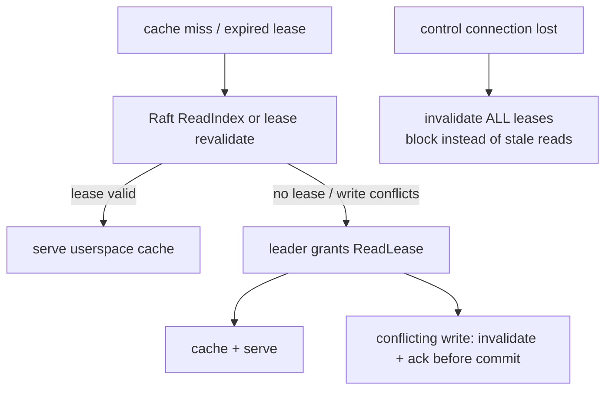

# SyncFS Architecture

> **Reconciled (2026-11-08):** Architecture reflects the unified baseline (FUSE + etcd/raft/v3 + QUIC + Pebble/BLAKE3 strict volume; Camp B state/POSIX-apply/quarantine folded in). Any native-directory/watcher/pull-based sections are superseded — see research/07-design-fork-reconciliation.md §3.5 and decision D-001.

## The design in one sentence

SyncFS places a Linux FUSE client in the application's I/O path and uses a
three-node, quorum-replicated volume service behind it. This is the smallest
design that can make POSIX mutations visible in one order across application
hosts while retaining local disks as the storage medium.

An inotify/fanotify daemon cannot provide that contract: it learns about a
write after the application has already observed success. It can replicate
files, but it cannot prevent split brain, revoke stale reads, coordinate locks,
or make `fsync` mean quorum durability.

## Intended deployment

```text
                    application hosts
       ┌──────────────────────────────────────────────┐
       │ Jira / Confluence / repo manager / artifacts  │
       │        POSIX syscalls at /srv/shared           │
       └──────────────────────┬───────────────────────┘
                              │ /dev/fuse
                    ┌─────────▼─────────┐
                    │ syncfs mount      │  client-only or co-located
                    │ cache + leases    │
                    └─────────┬─────────┘
                     mTLS QUIC│ (multiplexed streams)
         ┌────────────────────┼────────────────────┐
         ▼                    ▼                    ▼
┌────────────────┐   ┌────────────────┐   ┌────────────────┐
│ syncfs daemon  │   │ syncfs daemon  │   │ syncfs daemon  │
│ storage voter  │◄─►│ storage voter  │◄─►│ storage voter  │
│ local XFS/ext4 │   │ local XFS/ext4 │   │ local XFS/ext4 │
└────────────────┘   └────────────────┘   └────────────────┘
       node A                 node B                 node C
```

Three storage nodes should be independent failure domains with reliable
local SSD/NVMe storage and a low-latency LAN. Application hosts may be storage
nodes, but do not need to be. The MVP has no proxying through NFS or SMB and no
external database or control plane.

## Components

| Component | Status | Responsibility |
| --- | --- | --- |
| `syncfs mount` | M3 skeleton + compat surface (in-memory) | FUSE server, POSIX adaptation, local client journal, coherent cache. |
| `syncfs daemon` | storage core built; QUIC endpoints from M1-04 | QUIC transport, Raft peer, metadata state machine, chunk store, snapshot service, repair, metrics. |
| `syncfs admin` | CLI skeleton (stubs documented) | Bootstrap, volume lifecycle, PKI/enrollment workflow, membership changes, status, recovery. |
| Volume Raft group | M2-04 (3-node mesh tested) | Orders namespace/metadata mutations, locks, membership state, lease changes. |
| Chunk store | M2-02 + GC (M4-01) | Immutable 64 KiB BLAKE3 chunks, Packs, Pebble index, epoch sweeps. |

One Go binary, `syncfs`, with `admin` / `daemon` / `mount` subcommands
(`cmd/syncfs`). Separate processes for storage and mount roles; no
containers, Kubernetes, or service mesh required in production.

## Why a volume has a leader

Every volume has one Raft leader at a time. A client mount can connect to any
storage node, but followers redirect mutating requests to the current leader.
The leader serializes conflicting namespace and inode operations, issues cache
revocations, and proposes the resulting command to the Raft log. Raft terms and
committed indexes fence an old leader: a partitioned node may retain bytes in
its local staging area, but cannot make those bytes visible without a quorum.

This is intentionally different from GlusterFS-style independent bricks. A
private replica is not a writable source of truth. Only the committed volume
state is visible through a SyncFS mount.

## Write path

The critical invariant is: **a successful mutation has durable payload chunks
on a majority of current voters and a committed metadata command that references
those exact chunks.**

The leader combines independent requests for a short, bounded group-commit
window. It never acknowledges a mutation before the quorum condition holds.
Chunk upload and Raft replication are pipelined on separate QUIC streams, so a
large transfer does not block metadata or another file's small write.

```mermaid
sequenceDiagram
    actor App
    participant Fuse as syncfs mount
    participant Leader as volume leader
    participant Majority as storage majority (2/3)
    App->>Fuse: write/rename/fsync
    Fuse->>Leader: client assigns stable OpID
    Leader->>Majority: stage changed ranges as 64KiB COW chunks
    Majority-->>Leader: durable chunk receipts
    Leader->>Leader: revoke affected read/directory leases
    Leader->>Leader: propose preconditioned metadata command to Raft
    Leader->>Leader: wait Raft majority commit
    Leader-->>Fuse: apply to metadata state machine
    Fuse-->>App: success; invalidate remaining cache
```

Uncommitted chunks are harmless garbage: they have no namespace reference and are reclaimed only after a conservative epoch-based sweep. A follower may store
a committed log entry before it has all referenced chunks, but it may not apply
the entry or become leader until it has verified those chunks.

## Read and cache-coherence path

The normal mount mode is `strict`:

1. The volume leader grants a short, renewable read lease for an inode or
   directory to a connected mount.
2. The mount may serve cached data only while that lease is valid.
3. Before a conflicting mutation commits, the leader sends FUSE inode/dentry
   invalidations and waits for each live lease holder to acknowledge revocation
   or time out.
4. A mount that loses its control connection immediately invalidates its leases
   and no longer serves potentially stale cache pages.

This gives local cache speed to read-heavy shared homes without the hidden,
time-based stale reads normally associated with network filesystem clients.
For an operation that needs a fresh answer and has no lease, the mount performs
a linearizable `ReadIndex`-style read through the volume group.

The first strict release keeps mutable-file cache authority in the mount process:
it uses FUSE direct I/O for mutable data and zero/short kernel metadata TTLs.
That makes a paused or disconnected mount block or fail rather than allowing the
kernel to serve an expired page. Kernel page-cache optimization waits for
dedicated suspension and invalidation tests.

Writes are globally visible when their FUSE request succeeds. The initial
implementation does not hide dirty data behind writeback caching. That makes
the consistency contract straightforward; bounded batching and chunked updates
recover most of the small-write throughput without weakening visibility.



## Data model and local persistence

Each volume has an immutable logical object graph:

```text
directory inode ── dentry(name) ──► file inode ──► file manifest
                                                └── extent map ──► chunk hashes
```

- Inodes have stable random identifiers, ownership, mode, timestamps, xattrs,
  link count, and a monotonically increasing version.
- A file manifest maps logical ranges to fixed 64 KiB BLAKE3-addressed chunks;
  holes need no physical chunks.
- A metadata command carries expected inode/directory versions. A stale command
  fails rather than silently overwriting a concurrent change.
- Files, manifests, and chunks are immutable once committed. A small overwrite
  replaces only the affected extent(s) and manifest.

On each storage node, the daemon owns a private state directory such as:

```text
/var/lib/syncfs/
  identity/              node identity and trusted CA material
  groups/<group-id>/wal/ Raft WAL and hard state
  volumes/<volume-id>/
    state/               replicated metadata and chunk index
    packs/               append-only immutable chunk segments
    staging/             uncommitted upload data
    snapshots/           verified receive/send checkpoints
    quarantine/          forensic copies from failed local recovery
```

The metadata/index store is an embedded, rebuildable local projection of the
Raft log and snapshots; it is not an independent authority. Pebble serves the
ordered index; append-only pack files avoid the many-small-files penalty of
one host file per chunk. Its on-disk format is versioned and never shared directly with an
application.

## Failure model

| Event | Result |
| --- | --- |
| One storage voter fails | The two surviving voters retain quorum; the leader continues accepting quorum-durable writes. |
| Leader fails | Clients retry their stable operation ID after a new leader is elected. A request is either confirmed committed or reported uncertain; it is never blindly replayed as a new mutation. |
| Network partition | Only the side with a voter majority accepts writes. Minority mounts invalidate leases and return an availability error for new operations. |
| No quorum | Strict mounts do not serve new uncached data or mutations. Optional stale-read mode is a later, explicit policy and is not the default. |
| Follower disk/CRC failure | The node is removed from write eligibility, repaired from another replica, and must catch up before voting again. |
| Full storage disk | The leader returns `ENOSPC` before commit if a quorum cannot persist the mutation. |
| Mount process failure | The kernel FUSE connection is aborted; callers receive an error rather than silently using stale data. Systemd restarts and remounts the client. |

The fault model is not a substitute for backup. Replication protects against a
node failure, not an operator deletion or a quorum-corrupting disaster.

## Membership and node joining

New storage nodes are never admitted directly as voters:

1. An administrator creates an offline-transferable enrollment bundle containing
   the cluster ID, CA certificate, seed endpoint, one-time nonce, and approved
   node certificate fingerprint.
2. The new node proves possession of its certificate over mTLS and is added as a
   `learner`; it receives a verified snapshot plus subsequent log/chunk stream.
3. It checks hashes, applies through the current committed index, passes a
   scrub, and reports healthy capacity.
4. The administrator promotes it through Raft joint consensus. A replacement
   keeps the old voter until the new voter is fully caught up, then drains and
   removes the old node.

The MVP supports one membership change at a time and three storage voters. A
learner may be added for replacement without reducing durability. General
placement, sharding, and five-plus-node replica sets are later work.

## Security boundary

Every network connection uses mutual TLS 1.3 over QUIC with a private cluster
CA. Node IDs are bound to certificate identities, RPCs include a cluster ID,
and the protocol disables 0-RTT for all requests to prevent replayed mutations.
The CA can be created and operated entirely offline; no cloud identity provider,
DNS service, or external key-management service is required.

The MVP encrypts replication in transit. Operators who require disk encryption
use LUKS/dm-crypt under the private state directory. Application users never
receive host-level access to a brick, pack, or Raft directory.

## Implementation boundaries

The repository should grow along these package boundaries:

```text
cmd/syncfs/             process entry point and subcommands
api/v1/                 versioned Protobuf protocol definitions
internal/auth/          certificates, enrollment, RBAC, replay protection
internal/transport/     QUIC sessions, stream framing, peer routing
internal/raftstore/     Raft driver, WAL, snapshots, membership transitions
internal/metadata/      inode/dentry state machine and lock manager
internal/chunkstore/    pack format, chunk index, staging, GC, scrub
internal/volume/        write transaction orchestration and read leases
internal/client/        retries, idempotency journal, client cache protocol
internal/fusefs/        go-fuse adapter and Linux errno mapping
internal/admin/         control-plane commands and status output
internal/observability/ metrics, audit events, tracing, health checks
internal/testkit/       deterministic transport, disk faults, cluster harness
```

The normative protocol and acceptance criteria live in
`.spec/technical_spec.md`. This document is the
architecture map, not a replacement for its exact invariants.
