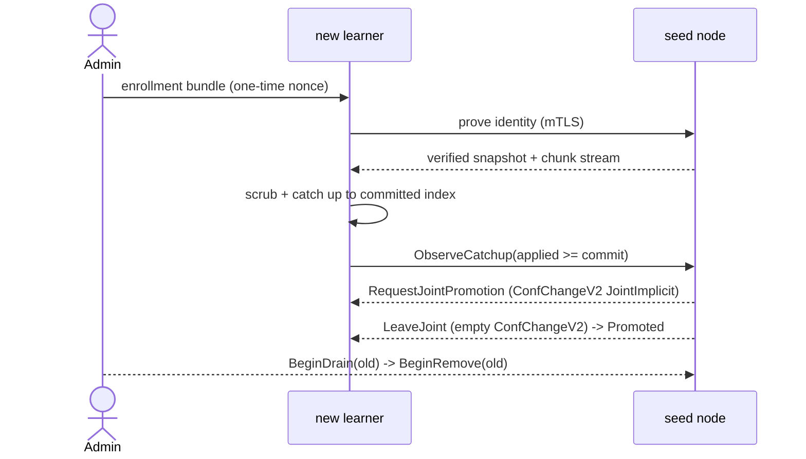
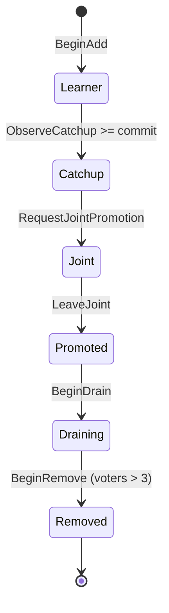

# Membership and bootstrap

Learner-first admission; one membership change at a time (Inv.8).
Promotion uses joint consensus (`ConfChangeV2` JointImplicit) then an
empty ConfChangeV2 to leave the joint configuration (ADR-0003).

