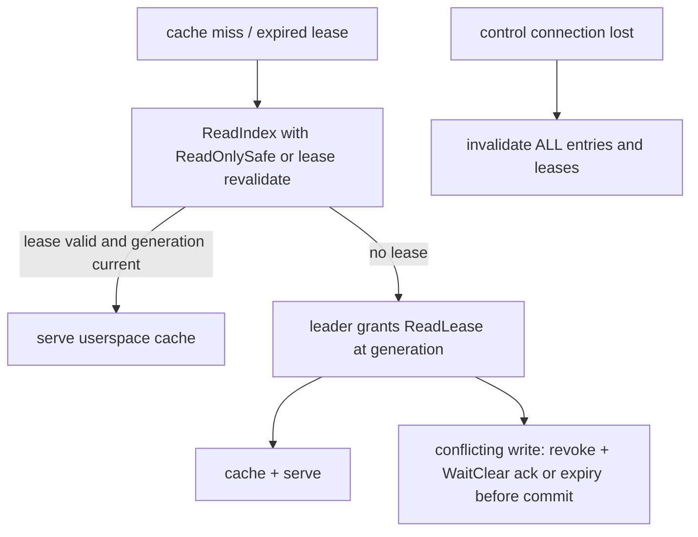

# Read and lease

Strict userspace cache with server leases; a drop of the control
connection invalidates everything (Inv.6). Three leases are distinct:
Raft leader lease (ReadIndex), client ReadLease (cache authority), and
POSIX lock lease (state-machine record).

