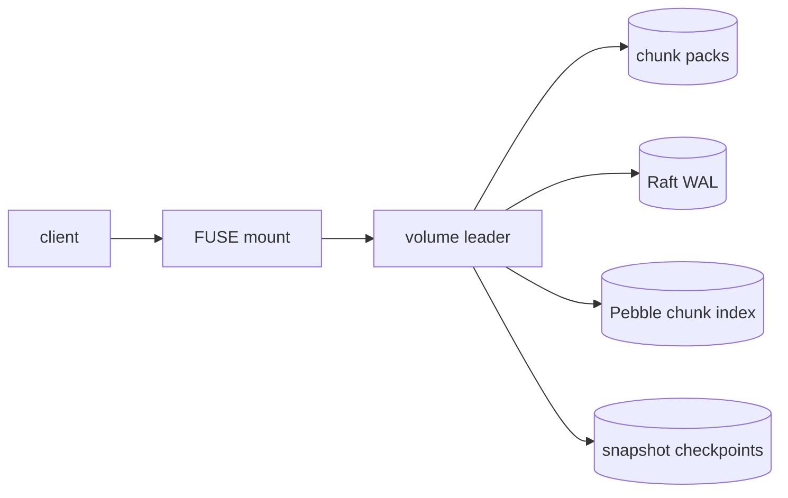

# Storage

Immutable 64 KiB BLAKE3 chunks in append-only packs; Pebble chunk
index (`WriteOptions.Sync`); Raft WAL with entries/hard-state
fdatasynced before `Ready.Messages` are sent; snapshot files
`[sha256(32)][len(4)][pb]` verified on read.

