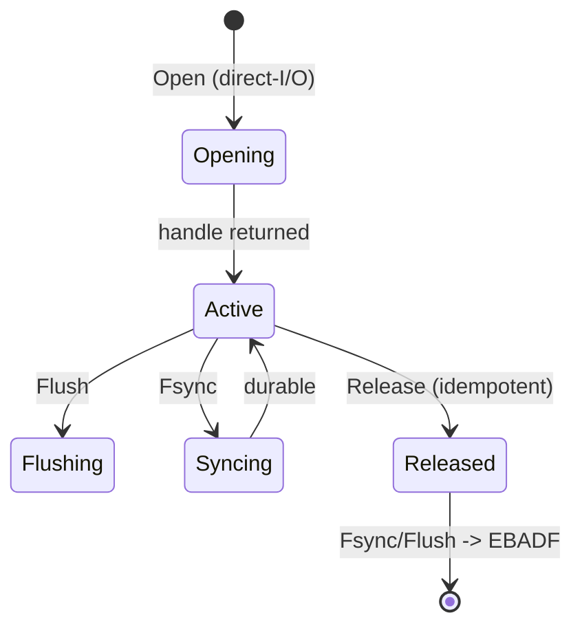

# Write path

Quorum-durable chunks precede the metadata commit (spec §8.2, Inv.3).
The mount extracts FUSE caller credentials in Lookup/Open, opens mutable
handles with direct I/O, and zeroes kernel metadata TTLs so no stale
entry survives a drop (ADR-0002). A syncer error rolls the write back
and returns EIO (fail closed). Metadata-only operations skip chunk
preparation but retain validation, lease revocation, Raft commit,
atomic apply, and idempotency.

```mermaid
sequenceDiagram
    actor App
    participant Fuse as syncfs mount
    participant Leader as volume leader
    participant Quorum as storage majority (2/3)
    App->>Fuse: write/rename/fsync
    Fuse->>Fuse: Lookup/Open: extract caller creds (EACCES) + direct-I/O
    Fuse->>Leader: OpID (stable 128-bit)
    Leader->>Leader: validate volume, caller, versions, session/lock/lease (step 1)
    Leader->>Leader: duplicate OpID returns retained result (step 2)
    Leader->>Leader: 64KiB COW chunks + candidate manifest (step 3)
    Leader->>Leader: local staging + BLAKE3 verify + durable (step 4a)
    Leader->>Quorum: stream chunks to majority (step 4b)
    Quorum-->>Leader: durable receipts (peer, hash, gen, bytes) (step 5)
    Leader->>Leader: revoke leases + wait ack or expiry (step 6)
    Leader->>Leader: propose WriteRanges (old versions, manifest, receipts, OpID) (step 7)
    Leader->>Leader: persist WAL + hard state before send; wait commit (step 8)
    Leader->>Leader: fetch missing chunks; atomic apply; record result (step 8)
    Leader-->>Fuse: invalidations, then success (step 9)
```


