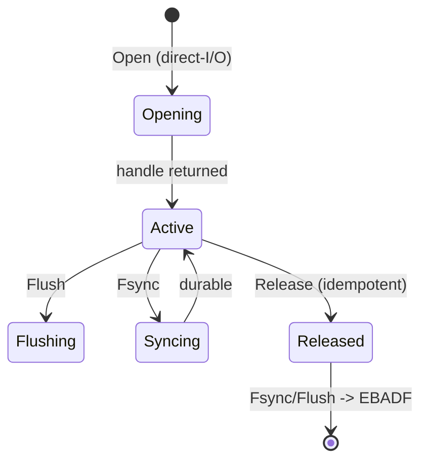

# Write path

Quorum-durable chunks precede the metadata commit (spec §8.2). The mount
extracts FUSE caller credentials in Lookup/Open, opens mutable handles
with direct I/O, and zeroes kernel metadata TTLs so no stale entry
survives a drop (ADR-0002). A syncer error rolls the write back and
returns EIO (fail closed).

```mermaid
sequenceDiagram
    actor App
    participant Fuse as syncfs mount
    participant Leader as volume leader
    participant Quorum as storage majority (2/3)
    App->>Fuse: write/rename/fsync
    Fuse->>Fuse: Lookup/Open: extract caller creds (EACCES) + direct-I/O
    Fuse->>Leader: stable OpID
    Leader->>Quorum: stage 64KiB COW chunks
    Quorum-->>Leader: durable receipts
    Leader->>Leader: revoke conflicting leases
    Leader->>Leader: propose preconditioned metadata to Raft
    Leader->>Leader: wait majority commit
    Leader-->>Fuse: apply to state machine
    Fuse-->>App: Fsync/Release lifecycle; invalidate cache
```


