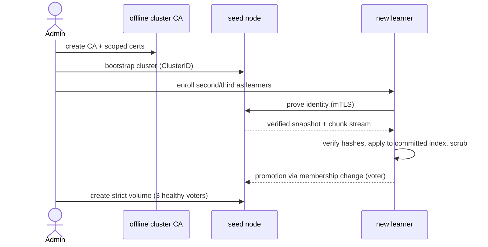

# SyncFS Operating Model

## Minimum production topology

- Three Linux storage nodes, each with one reliable local ext4/XFS filesystem
  under `/var/lib/syncfs` and independent power/failure domains.
- A low-latency network between storage nodes; 10 GbE and power-loss-protected
  NVMe are the reference hardware profile for small-write latency.
- One `syncfs mount` process on every host that runs an application using a
  shared directory. The mount starts before the application systemd unit.
- UDP access to the configured SyncFS peer port between cluster members. No
  internet dependency is required.

Running all three voters on one physical host, a single power domain, or a
network path that routinely partitions is not HA.

## Bootstrap and volume lifecycle

The operator-facing CLI is validated in `cmd/syncfs` (see
`docs/reference/cli.md` for exact flags and exit codes):

```text
# On an offline administrator workstation
syncfs admin pki init --cluster-id <uuid>
syncfs admin pki issue-node --node-id node-a

# On the first storage node
syncfs daemon --config /etc/syncfs/node.yaml
syncfs admin bootstrap --cluster-id <uuid> --out /etc/syncfs/cluster.yaml

# Add node-b and node-c as learners, then promote each after verification
syncfs admin member --node node-b --op add-learner
syncfs admin member --node node-b --op promote

# Create a strict shared directory and mount it on an application host
syncfs admin volume --volume jira-shared-home --op status
syncfs mount --volume jira-shared-home --target /srv/jira/shared-home
```



The cluster refuses to create a strict volume until it has three healthy
storage voters. Configuration that changes shared state, membership, or a
volume's compatibility contract is proposed through the control plane and
committed by Raft; it is never accepted from an arbitrary local YAML edit.

## Example volume declaration

```yaml
apiVersion: syncfs.io/v1alpha1
kind: Volume
metadata:
  name: jira-shared-home
spec:
  consistency: strict
  replication:
    voters: 3
    chunkSizeBytes: 65536
    durability: quorum
  limits:
    quotaBytes: 214748364800
    maxFileBytes: 17179869184
  security:
    administrators:
      - ops@example.invalid
    allowedNodeGroups:
      - jira-app
```

`chunkSizeBytes` is an on-disk format decision and cannot be changed in place.
Quota enforcement, maximum file size, and the exact authorization schema are
implemented before the volume API is declared stable.

## Air-gapped identity and node enrollment

The security model uses an offline-capable private cluster CA:

1. The CA private key remains with the operator, not on every storage node.
2. Each daemon and mount host receives a scoped certificate and trusted CA
   bundle through the operator's existing secure transfer process.
3. An administrator pre-authorizes a new node's ID and certificate fingerprint
   in cluster state, then creates a single-use enrollment bundle.
4. The learner connects directly to a seed over mTLS, proves its identity,
   verifies the cluster ID, downloads a snapshot, and is promoted only after
   catch-up and scrub verification.

All peer, client, snapshot, and chunk traffic runs over QUIC protected by TLS
1.3. TLS session resumption may be used, but 0-RTT application data is disabled
because mutations must not be replayable. The MVP does not encrypt local disks;
use LUKS/dm-crypt beneath the state directory where at-rest encryption is
required.

## Recovery and maintenance rules

| Situation | Operator action |
| --- | --- |
| One failed node | Replace or repair it as a learner; do not remove a healthy voter first. |
| Quorum lost | Stop making membership changes. Restore enough original voters to form a quorum, or use a documented, explicit disaster-recovery procedure. |
| Disk corruption | Keep the node non-voting, preserve the failed state directory for forensics, and repair by verified snapshot. |
| Application sees `EIO`/`ENOTCONN` | Treat the affected operation as uncertain, inspect its operation ID, and reconcile before retrying a non-idempotent action. |
| User deletion or ransomware | Restore from an independent backup. Replication intentionally preserves a committed deletion. |
| Certificate rotation | Add the new trust/certificate material, verify every peer, then remove the old material through a committed rotation workflow. |

The administrator should never copy files directly into a storage node's state
directory, edit a Raft/WAL file, or mount its internal data path for
applications. Those actions can create data that is invisible, corrupt, or
impossible to safely reconcile.

## Required observability

Every node must expose structured logs and metrics for:

- cluster and volume leader/quorum state;
- committed, applied, and snapshot indexes; peer byte/index lag; and learner
  catch-up progress;
- client cache leases, revocation wait time, lock wait time, and ambiguous
  operation count;
- write/read latency histograms split by FUSE operation and quorum phase;
- chunk checksum failures, repair backlog, garbage-collection backlog, and
  available disk capacity; and
- certificate expiry, enrollment events, membership changes, and administrative
  audit records.

Alert before a voter is full or stale enough to threaten the remaining quorum;
do not wait for a write-path failure.
